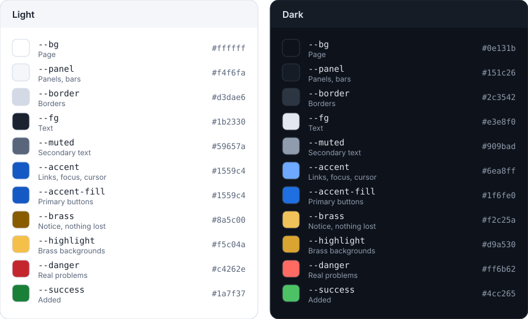

# The Plumb brand

How Plumb looks and sounds, and why. Read this before changing the logo,
a colour, or the words on screen. It follows from the principles in
[VISION.md](../VISION.md): *never lose text, faithful to the file, private,
ready in a second, calm.*

## The name

A **plumb line** is a weight on a string. It hangs exactly true, and builders
use it to check that a wall is straight. Plumb keeps your file the same way:
true to what it was, plus only the changes you made.

- Write it **Plumb**, with a capital P, in sentences and titles. The wordmark is
  lower case (*plumb*); that's the only place.
- It's a name, not a description: "Plumb", not "the Plumb editor" or "Plumb
  Editor". When a description helps, use the tagline.
- **Tagline:** *The private, zero-install editor for the text files on your own
  computer.*

## The mark

**The text cursor hangs true as a plumb line, ending in a brass plumb bob**, on
an ink-blue tile. Two short lines of text beside it place the cursor at the end
of a line of writing. The cursor says *editor*; the plumb line says *exactly
true*.

| File | Use |
|---|---|
| [`public/icon.svg`](../public/icon.svg) | The app icon: the full mark, with the lines of text |
| [`public/favicon.svg`](../public/favicon.svg), `favicon.ico` | Browser tabs and the header: the line and bob only, drawn bolder, because the lines of text turn to noise at 16 px |
| [`build/icons/icon-full-bleed.svg`](../build/icons/icon-full-bleed.svg) | Android (maskable) and Apple touch icons: a square tile, with the mark inside the central safe circle |
| [`docs/logo.svg`](logo.svg) | The logo: the icon and the wordmark, for the README and anywhere Plumb is introduced |

The PNGs and `favicon.ico` are drawn from the SVGs: change an SVG, then run
`npm run icons`. Never edit the bitmaps by hand.

**The wordmark** is lower-case *plumb* in a single-weight geometric line with
round ends. Its **l** is itself a plumb line, with a small brass bob resting on
the baseline. It switches between dark and light ink with the reader's colour
scheme.

**Do:**
- Keep the mark upright. A plumb line only hangs one way.
- Leave space around it, at least a quarter of its width.
- Use the favicon version below 48 px.

**Don't:**
- Recolour the tile or the bob, add outlines or shadows, or set the mark on a
  busy background.
- Draw the bob with a flat top or a handle: it starts to look like a shovel
  (the first draft did).
- Stretch it, rotate it, or use the lines of text without the cursor.

## Colour

Plumb's colours come from the logo: **ink blue** for the interface, and
**brass** for things that ask for attention while nothing is wrong. Everything
else is quiet grey that leans slightly towards the blue.

The palette lives in one place: the custom properties at the top of
[`src/style.css`](../src/style.css), once for light and once for dark. The
picture above is drawn from it (`npm run palette`).

### What each colour means

| Colour | Means | Used for |
|---|---|---|
| **Ink blue** (`--accent`, `--accent-fill`) | *This is Plumb; this is where you are* | Links, focus rings, the current item, pressed toggles, primary buttons, the text cursor |
| **Brass** (`--brass`, `--highlight`) | *Notice this. Nothing is lost* | Changes not yet saved to a file (the ● on tabs, in the sidebar and on the start page, and *Not saved to file*), find matches, the banner for a file changed or deleted on disk |
| **Red** (`--danger`) | *Something went wrong, or will if you go on* | A save that failed, an invalid regular expression, JSON and YAML problems, *Delete forever* |
| **Green** (`--success`) | *Added* | Added text in History, replacements in Search |
| **Greys** (`--fg`, `--muted`, `--border`, `--panel`, `--bg`) | Everything else | Text, secondary text, structure |

**Brass is the important rule.** Unsaved text is a normal state in Plumb, not
an error: it's already kept in the browser and in version history. Showing it
in red would make people anxious about the one thing Plumb promises never
happens. So "not saved to the file yet" is brass, and red is kept for real
problems. When you add a state, ask: *is anything lost, or about to be?* If
not, it isn't red.

### Rules for changing colours

- **Use the variables.** No colour values in components or in `cm.js`; the
  test fails if one appears outside the palette (white on primary buttons and
  the print styles are the only exceptions).
- **4.5:1 for all text**, on every background it appears on, in both themes,
  and 3:1 for the cursor and focus rings. `test/palette.test.js` checks this,
  including tinted backgrounds such as banners, selections and find matches.
  If you add a new pairing, add it to the test.
- **Change light and dark together.** The dark colours are written twice (for
  the system's dark mode, and for *Dark* in Settings); the test checks the two
  copies match.
- **The title bar** (`--theme-bar`) is also set in `index.html`,
  `src/themebar.js` and the manifest; the test checks they agree.
- **Syntax colours** stay close to what people know from other editors, so code
  reads as expected. Change them only for contrast.
- **No new colours for decoration.** A new colour needs a new meaning.

## Type

Plumb uses the system's fonts: no web fonts, so nothing to download and
nothing to wait for (*ready in a second*).

- **Interface:** `system-ui` at 15 px.
- **Text and code:** the system's monospace font, or the one chosen in
  Settings. Some writers prefer a proportional font, so Settings offers those
  too.
- **Weight** marks what matters (the file name, a heading); colour doesn't.

## Voice

Plumb talks the way the principles ask: **calm, plain, and specific.**

- **Plain words.** "Save", not "Persist". "Changed on disk", not "External
  modification detected".
- **Say what happened, then what you can do.** "“notes.md” changed on disk,
  and you have changes not saved to it." Then the choices: *Reload from disk*,
  *Keep mine*.
- **Reassure with facts, not adjectives.** "Your text is kept in History", not
  "Don't worry!"
- **No exclamation marks, no blame, no jokes in error messages.**
- **Sentence case** for buttons, menus and headings: *Open folder…*, not *Open
  Folder…*. An ellipsis means the action asks for more before it happens.
- **Name the browser plainly** when something isn't possible there: "Opening
  folders needs Chrome or Edge. Your browser can open single files."
- British spelling in the documentation and comments (*colour*, *behaviour*).

## Screenshots

The README's screenshots ([light](screenshots/plumb-light.png),
[dark](screenshots/plumb-dark.png)) show a small folder, a Markdown file with
its preview, and a second file with unsaved changes, so they show the brass dot
too. They're taken from the production build by `npm run screenshots`, on the
same stand-in disk the end-to-end tests use. Run it after any visible change to
the interface, and commit both pictures.
